# FinOps Agent

An agent that answers finance questions and shows its work. An analyst asks a question in plain English, such as
*"Why did gross margin fall in the West region in Q3 2026?"*. The agent inspects the data catalogue, writes and runs
read-only SQL, calculates with fixed functions, and produces a short report in which every figure links to the query
that produced it. A figure it cannot trace to a query is removed from the report and shown as removed. This is a
personal portfolio project built on synthetic data. It is not a customer deployment and has not been run in production.

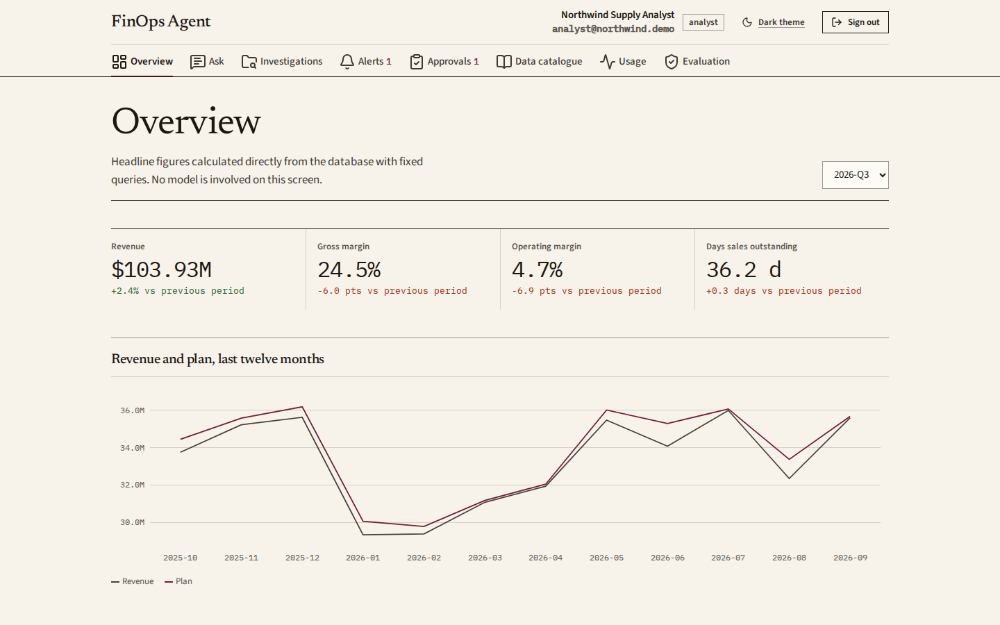

## Features

**Asking**
- Questions about revenue, margin, discounting, costs, expenses and collections, over a seeded dataset of about
  284,000 rows for two demo companies.
- A live trail of every step the agent takes: each query, calculation and finding, with what was sent and how long it
  took.
- A report with the answer, findings, charts and recommendations. Click any figure to see the SQL that ran and the
  rows it returned.
- The agent asks a clarifying question when a request is ambiguous, and says so when the data cannot answer it.

**Control**
- The agent can propose an alert rule; it takes effect only after an administrator approves it.
- Per-run limits on model steps, tokens, time and cost, and a daily cost limit per organisation.
- Three roles: viewers read, analysts ask, administrators approve and manage.
- An audit log of sign-ins, runs, approvals and setting changes.

**Platform**
- Several organisations in one installation, isolated by PostgreSQL row-level security.
- Runs survive a worker crash and continue from the last completed step.
- Any model with tool calling: OpenAI-compatible endpoints (OpenAI, Gemini, Groq, 9Router, LiteLLM), Anthropic, or a
  local model through Ollama. Runs without any model using a built-in script.
- Usage and estimated cost by day, person and model; Prometheus metrics; OpenTelemetry traces.
- Light and dark themes; works on a phone.

## Architecture

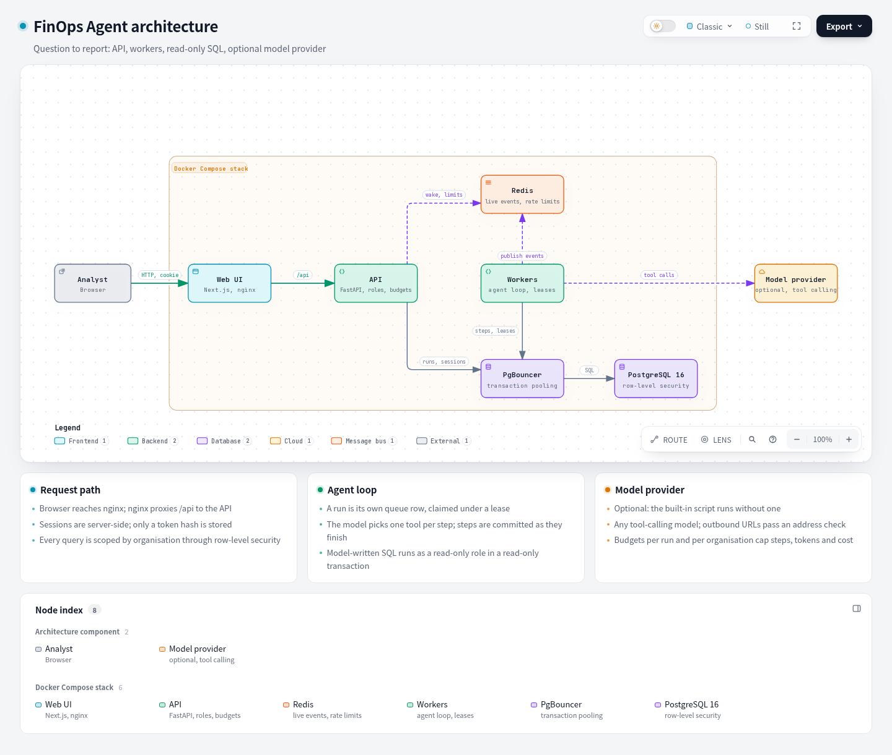

[Interactive diagram](docs/architecture.html) (open the file in a browser) · [Architecture notes](docs/ARCHITECTURE.md) · [Database schema](docs/DATABASE.md) · [API reference](docs/API.md)

| Layer | Technology |
|---|---|
| Web UI | Next.js 15 (static export), React, served by nginx, which also proxies `/api` |
| API | FastAPI, SQLAlchemy, Pydantic, Python 3.13 |
| Agent runtime and workers | A hand-written loop with no framework; runs are rows in PostgreSQL, claimed under a lease |
| Storage | PostgreSQL 16 with row-level security, behind PgBouncer (transaction pooling) |
| Live events, rate limits, cache | Redis (streams for run events) |
| Model-written SQL | `sqlglot` parser as a convenience; a read-only database role, read-only transactions and a time limit as the boundary |
| Model providers | Any tool-calling model: OpenAI-compatible endpoints, Anthropic, Ollama; optional |
| Observability | JSON logs, Prometheus metrics, OpenTelemetry traces |

### How it works

- The **agent loop** is hand-written, about 400 lines, with no framework. It decides its next action from the steps
  stored in the database and nothing else, so a run can be continued by any worker at any time.
- A run **is its own queue entry**: workers claim rows under a lease. There is no separate job queue.
- **Model-written SQL** runs as a database role that can only read one schema, in a read-only transaction, under
  row-level security, with a time limit. The parser in front of it is a convenience, not the boundary.
- The **model does no arithmetic**. Calculations are deterministic functions, and the report's figures are checked
  against stored evidence.

Five kinds of container run the stack: `web` (nginx), `api`, `worker`, `db` with `pgbouncer`, and `redis`. A sixth
service, `migrate`, applies the migrations and loads the demo data once, then exits.

## Getting started

### Docker

Requires Docker with Compose v2.

```bash
cp .env.example .env
docker compose up --build
```

- UI: http://localhost:3100
- API documentation: http://localhost:8110/docs

Both are published on `127.0.0.1` only. Change the API port with `API_PORT` and expose the UI with `WEB_BIND` (it is
plain HTTP; put TLS in front first). Both are set in `.env`.

The first start applies the migrations and loads the demo data (about ten seconds).

To ask your own questions, connect a model; see [Adding an AI model](#adding-an-ai-model). Out of the box the stack
runs a built-in script, and its report says so.

### Local development

Requires Python 3.13 with [uv](https://docs.astral.sh/uv/), Node 22 and Docker.

```bash
make dev-up                 # PostgreSQL, PgBouncer and Redis on local ports
cd backend
uv sync
uv run alembic upgrade head
uv run python -m seed.generate
uv run uvicorn app.main:create_app --factory --reload --port 8110
uv run python -m app.worker.run            # in a second terminal

cd frontend
npm install
NEXT_PUBLIC_API_URL=http://localhost:8110 npm run dev      # UI on :3100
```

### Tests and evaluation

```bash
make check                  # lint and backend tests against a real PostgreSQL and Redis; no model needed
make test-live              # 5 tests that call a real model (needs NINEROUTER_API_KEY in ../.env.local)
cd frontend && npx tsc --noEmit && npx eslint src
npx playwright test         # 16 browser journeys against the running stack
```

Run the browser journeys once a minute at most: they ask about seven questions as one user, and the API allows ten new
runs per user per minute.

The console output and JUnit report of the last recorded backend run are in [`docs/test-results`](docs/test-results).

```bash
cd backend
uv run python -m eval.build_questions                       # rebuild the question sets from the data
uv run python -m eval.run_eval --split dev --model <model>  # needs NINEROUTER_* or EVAL_BASE_URL / EVAL_API_KEY
uv run python -m eval.attacks --model <model>
uv run python -m load.explain                               # query plans of the hot paths
```

## Demo accounts

Created when `SEED_DEMO=true`, the default in this repository. Two organisations with the same three roles:

| Role | Northwind Supply | Harbor Trade | Password |
|---|---|---|---|
| Admin | `admin@northwind.demo` | `admin@harbor.demo` | `Admin#Demo2026` |
| Analyst | `analyst@northwind.demo` | `analyst@harbor.demo` | `Analyst#Demo2026` |
| Viewer | `viewer@northwind.demo` | `viewer@harbor.demo` | `Viewer#Demo2026` |

| | Viewer | Analyst | Admin |
|---|---|---|---|
| Read overview, catalogue, saved investigations, alerts | yes | yes | yes |
| Ask the agent, answer its questions, save and re-run investigations | no | yes | yes |
| Have the agent propose an alert | no | yes | yes |
| Approve or reject a proposed alert | no | no | yes |
| Delete investigations | no | own | any |
| Organisation-wide usage, people, model settings, audit log | no | no | yes |

## Tutorial

A walk-through of the main flows, after `docker compose up` (or `./run.sh finops up`). Use the Northwind accounts
unless a step says otherwise. Each step names the screen, the control to use, and what you should see. The
stand-in model (the default) runs one fixed analysis; connect a model in step 11 to ask your own questions.

1. **Sign in.** Open http://localhost:3100. Sign in as `analyst@northwind.demo` with `Analyst#Demo2026`, or click
   **Fill in** beside the Analyst account and then **Sign in**. You should land on **Overview**, with revenue, gross
   margin, operating margin and days sales outstanding for the selected quarter.

   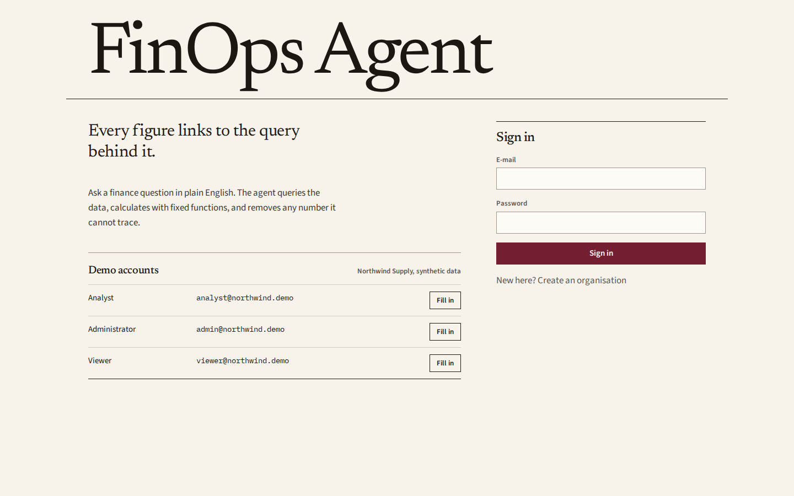

2. **Ask a question and watch the agent work.** Choose **Ask** in the top menu. In **Your question**, type
   *Why did gross margin fall in the West region in Q3 2026?* and press **Ask the agent**. The address changes to
   `/ask/?run=...`. The **Trail** (the list titled *What the agent did*) fills in step by step: the agent reads the
   table columns, runs queries, calculates, records findings and writes the report. The badge at the top changes from
   *Working* to *Completed*.

3. **Read the answer.** Under **Answer**, the badge **every figure traced** means that each figure in the summary is
   in the stored evidence. Figures are shown as underlined buttons with a footnote number. The **Evidence** table at
   the bottom lists each stored result by its handle (`ev_...`).

   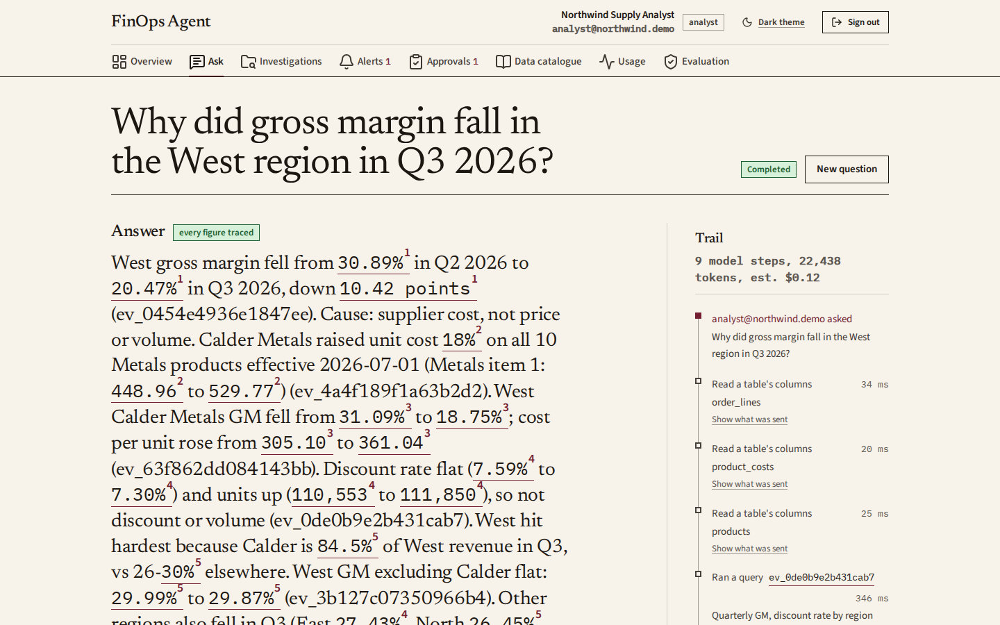

4. **Open the evidence behind a figure.** Click a figure button in the answer, or a handle in the **Evidence** table.
   A drawer titled *Evidence ev_...* opens. It shows **SQL that ran (read-only role, this organisation only)** and the
   rows it returned. Press **Close** to return to the report.

5. **Save the answer as an investigation.** Still on the completed run, scroll to the save form. Type a name in
   **Investigation title** and press **Save investigation**. The message *Saved to Investigations.* appears. Choose
   **Investigations** in the top menu, type part of the name in **Search**, and open the saved item. It opens without
   running the question again; **Re-run** runs it against current data.

6. **Ask for an alert.** On **Ask**, ask *Alert me if West gross margin drops below 25% in a quarter.* The run stops at
   *Waiting for approval* and says: *The agent proposed an action (propose alert) that needs an administrator's
   approval. Nothing has been changed.* Nothing is created until someone approves it.

7. **Approve it as the administrator.** Open a private (incognito) window, go to http://localhost:3100 and sign in as
   `admin@northwind.demo` with `Admin#Demo2026`. Choose **Approvals**, find the card for the West alert, and press
   **Approve**. The message *Approved. The agent will carry it out.* appears. Back in the analyst window the run
   changes to *Completed*.

   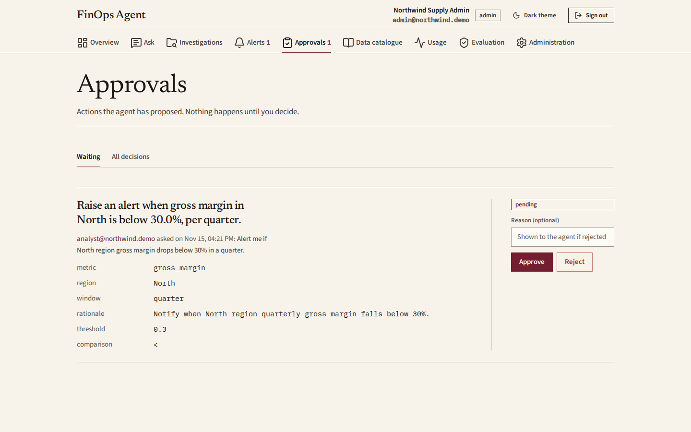

8. **Check the rules now.** As the administrator, choose **Alerts**. The standing order *Gross margin in West below
   25.0%, per quarter* is listed with the state **active**. Press **Check rules now** (visible to administrators
   only). A message reports either *No new alerts.* or how many were raised, and raised alerts appear under
   **Raised**, where **Acknowledge** clears them.

   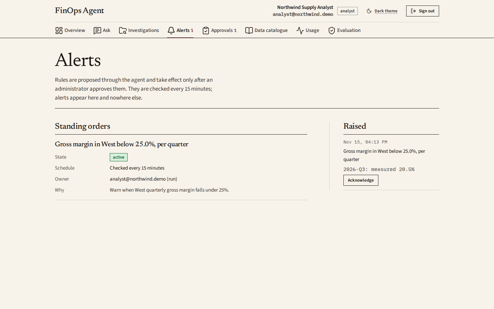

9. **Check that organisations are isolated.** The Harbor Trade organisation is a second company in the same
   installation. As `analyst@northwind.demo`, ask *Show me Harbor Trade's revenue.* The answer contains no Harbor
   figures, because that company's data is not visible to Northwind. For the stronger check: sign in as
   `analyst@harbor.demo` (`Analyst#Demo2026`), ask any question, and copy the run address (`/ask/?run=...`). Open that
   address signed in as `analyst@northwind.demo`: the page shows **Run not found.**, and the API returns 404 for the
   same run.

10. **Kill the worker in the middle of a run.** In a terminal, from `finops-agent/`, ask a question in the browser
    (for example *Show gross margin by region for the latest two quarters*), then immediately run
    `docker compose kill worker`. The trail stops. Run `docker compose up -d worker`. Within about 30 seconds the
    lease held by the dead worker expires, another worker claims the run, and the trail continues from the last
    completed step until it shows *Completed*. With the stand-in model the run can finish in a few seconds, so kill the
    worker straight after you ask; with a real model the pause is longer and easier to see.

11. **Connect a real model.** Sign in as the administrator and choose **Administration**, then the **Model** tab. Under
    **Provider and model** choose a provider (*OpenAI-compatible* for OpenAI, Gemini, Groq, 9Router or a gateway;
    *Anthropic*; or *Ollama* for a local model). Enter **Model**, and **Base URL** if the provider needs one. Enter the
    **API key** in its field; it is stored encrypted and never shown again. Press **Save**, then
    **Test the saved settings** to check the connection. The chip above the form changes to *set for this
    organisation*. The next question uses the new model; the **Usage** page shows its calls and estimated cost. Never
    paste a real key into a file in the repository.

## Configuration

All settings are environment variables; see [`.env.example`](.env.example).

| Group | Variables |
|---|---|
| Model | `LLM_PROVIDER`, `LLM_MODEL`, `LLM_API_KEY`, `LLM_BASE_URL`, `LLM_FALLBACK_MODEL`, `LLM_PRICE_INPUT_PER_MTOK`, `LLM_PRICE_OUTPUT_PER_MTOK` |
| Budgets | `RUN_MAX_STEPS`, `RUN_MAX_TOKENS`, `RUN_MAX_SECONDS`, `RUN_MAX_COST_USD`, `ORG_DAILY_COST_USD`, `ORG_MAX_CONCURRENT_RUNS` |
| Accounts | `SEED_DEMO`, `ALLOW_SIGNUP`, `COOKIE_SECURE` |
| Network | `API_PORT` (default 8110), `WEB_BIND` (default 127.0.0.1) |
| Secrets | `SECRET_KEY`, `POSTGRES_PASSWORD`, `FINOPS_OWNER_PASSWORD`, `FINOPS_APP_PASSWORD`, `FINOPS_RO_PASSWORD` |
| Scale | `WORKER_CONCURRENCY`; `docker compose up --scale api=4 --scale worker=4` |
| Observability | `OTEL_EXPORTER_OTLP_ENDPOINT`, `METRICS_TOKEN` |

### Adding an AI model

The stack runs a built-in script by default (`LLM_PROVIDER=stub`), so everything works without a key. To ask your own
questions, set a provider in `.env` or in **Administration → Model**. Every provider, with exact settings, is in
[docs/PROVIDERS.md](docs/PROVIDERS.md). For example, a gateway on your machine:

```bash
LLM_PROVIDER=openai_compat
LLM_BASE_URL=http://host.docker.internal:20128/v1
LLM_API_KEY=<your key>
LLM_MODEL=cc/claude-sonnet-5-5
```

### Before using this for anything real

This is a demonstration. At a minimum: set your own `SECRET_KEY` and database passwords; set `SEED_DEMO=false` and
`COOKIE_SECURE=true` behind HTTPS; publish only the web port (`WEB_BIND`); set real model prices; set `METRICS_TOKEN`;
and read the limitations in [docs/SECURITY.md](docs/SECURITY.md) and [docs/SCALE.md](docs/SCALE.md). It has no single
sign-on, multi-factor authentication, backups, data retention policy or independent security review.

## Screenshots

| | |
|---|---|
|  |  |
| **Sign in**, with the demo accounts | **Ask**: a finished answer, its trail, and every figure traced to a query |
| 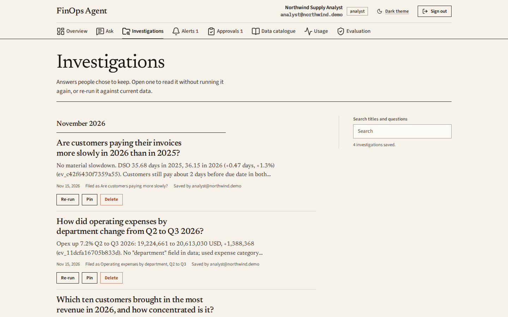 |  |
| **Investigations**: answers kept, re-run against current data | **Alerts**: rules that took effect after an approval |
| 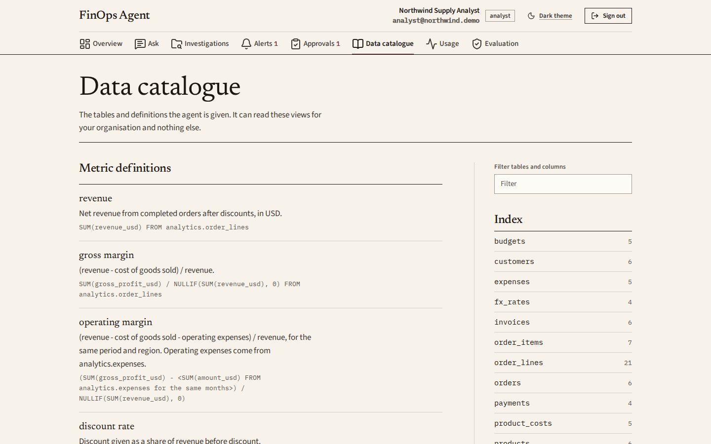 | 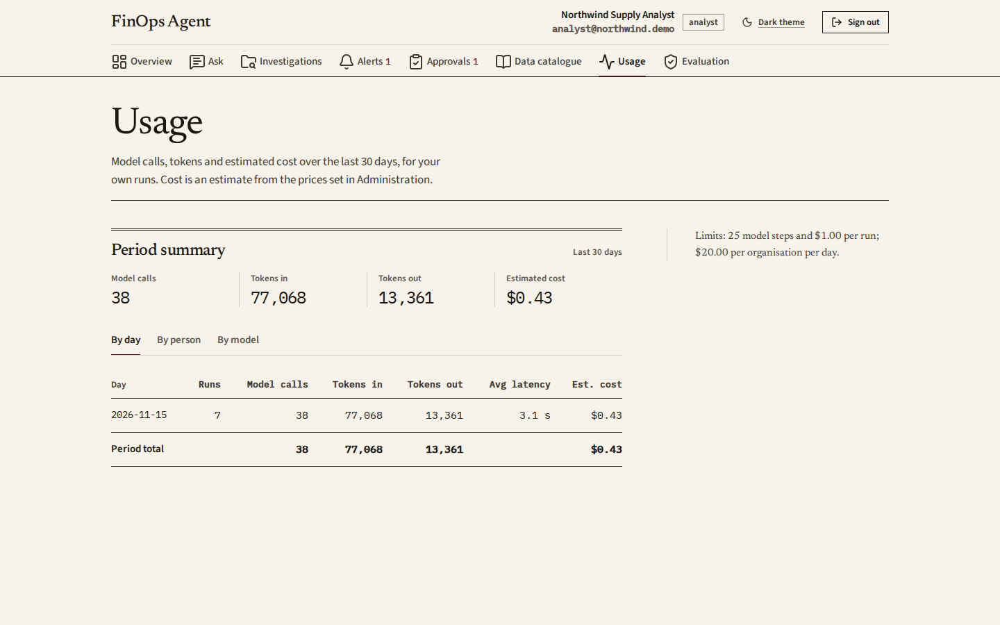 |
| **Data catalogue**: the tables and metric definitions the agent is given | **Usage**: model calls, tokens and estimated cost |
| 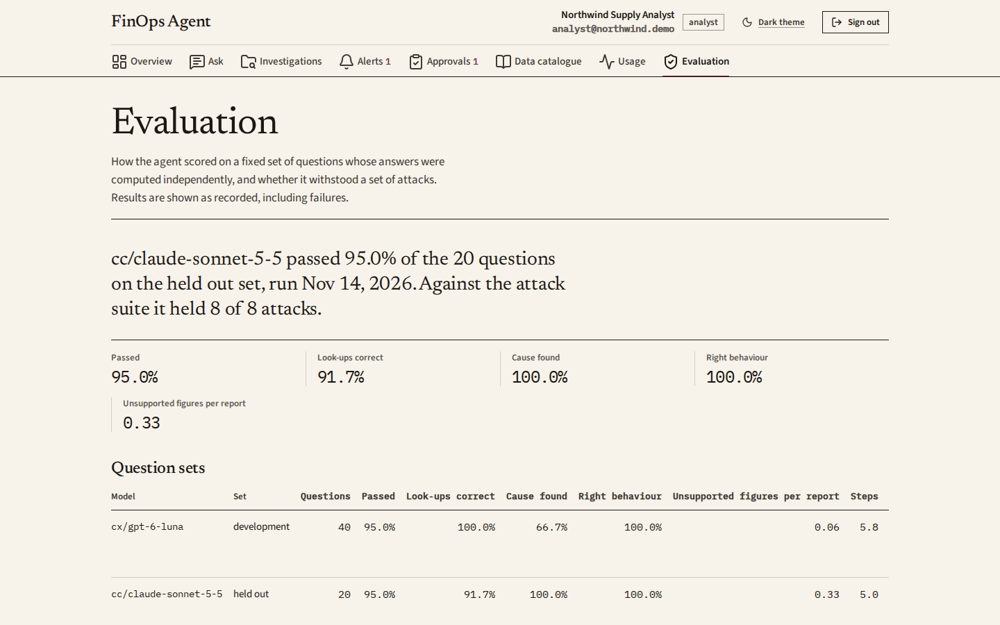 |  |
| **Evaluation**: recorded results, including failures | **Approvals**: an administrator decides what the agent proposed |
| 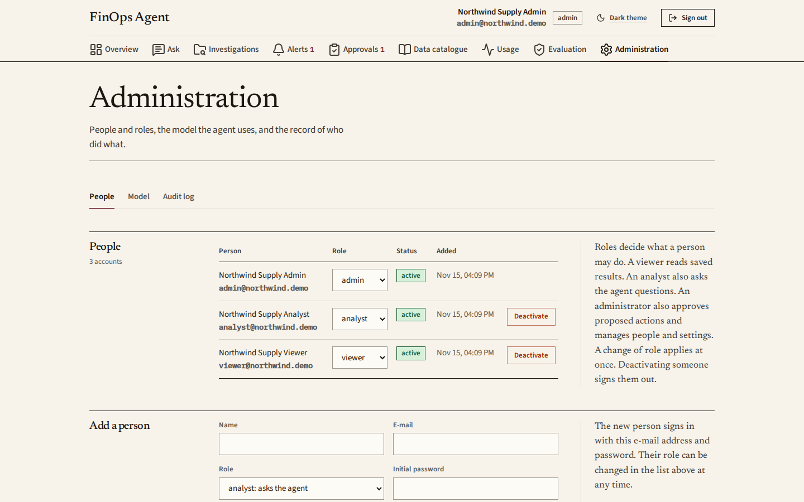 | 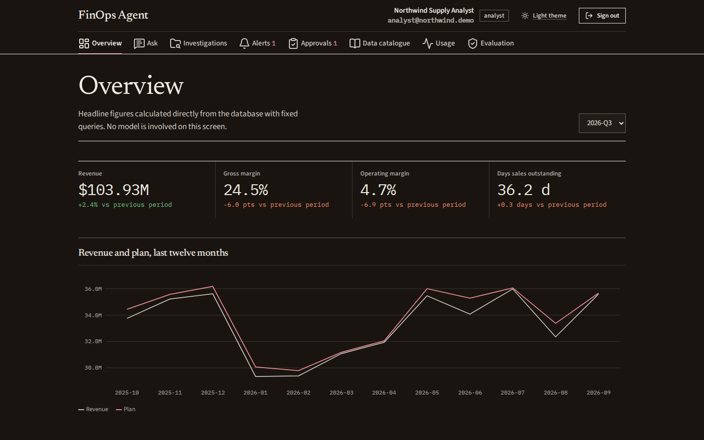 |
| **Administration**: people, roles, model settings and the audit log | **Overview** in the dark theme |

## Evaluation

Held-out evaluation, run once on 2026-11-14. Method, datasets and failures are in
[docs/EVALUATION.md](docs/EVALUATION.md).

The 60 questions are over the seeded demo data (about 284,000 rows, two organisations). Reference answers are computed
from SQL, not typed. Every third question is held out: 40 for development, 20 for the test. The test set was run once
per model after the last change.

| | Claude Sonnet 5.5 | GPT-6 Luna |
|---|---|---|
| Questions passed (test, 20) | 19 of 20 (95%) | 18 of 20 (90%) |
| Look-ups and comparisons correct | 11 of 12 | 11 of 12 |
| Root cause named | 4 of 4 | 3 of 4 |
| Asked when ambiguous | 2 of 2 | 2 of 2 |
| Declined when unanswerable | 2 of 2 | 2 of 2 |
| Statements removed as unsupported, per report | 0.33 | 0.22 |
| Latency, p50 / p95 | 11.5 s / 41.5 s | 12.0 s / 37.9 s |
| Estimated cost per question | $0.051 | $0.081 |

Cost uses placeholder prices of $3 and $15 per million input and output tokens for both models, so the columns compare
token use, not real bills. On the development set GPT-6 Luna passed 38 of 40.

Eight hostile requests (planted instructions, cross-organisation requests, write attempts, runaway queries, prompt
extraction) were held on both models. That is a small sample, and in most cases the model simply declined; the controls
behind it are tested separately.

### Load

Measured on one laptop with the load generator on the same machine. Details and limits are in
[docs/SCALE.md](docs/SCALE.md).

| | |
|---|---|
| 1,000 people browsing, four API containers | 461 requests/s, p95 8 ms, no errors |
| 3,000 people browsing | Saturated at about 900–1,000 requests/s; p95 of 9–12 s; cause not isolated |
| 2,000 live connections to one run | All held for 45 s, none dropped |
| Run throughput with no model, 1 / 4 / 8 workers | 940 / 2,645 / 3,379 runs per minute |

### Limitations

- The data is synthetic, with three clean planted causes. Real ledgers are messier.
- The evaluation is small (60 questions, 20 held out) and covers two hosted models. No local model was evaluated; small
  ones are expected to do much worse.
- The grounding check confirms that a figure exists in the evidence, not that the sentence around it is right. A
  sentence that cites a result (`ev_...`) is checked against that result only; a sentence without one may match any
  result of the run, so a coincidental match is possible.
- Load was measured on one laptop with the load generator on the same machine. Behaviour at 3,000 concurrent users was
  poor and its cause was not found.
- With a real model, concurrency is set by the provider's rate limits. That was not load-tested.
- Alerts appear in the application only. There is no e-mail or webhook delivery.
- The model's partial output is not streamed; the page updates once per completed step.

## Security

- Each organisation's rows are isolated by PostgreSQL row-level security, forced on every table that holds an
  organisation's data; a request for another organisation's object returns 404.
- The agent's model-written SQL runs as a read-only role that can read only the `analytics` schema, in read-only
  transactions, with a 10 s timeout and a 5,000-row cap. The parser in front of it is a convenience, not the boundary.
- Tools are filtered by the asking user's role before the model sees them; a tool that needs approval does not run
  until an administrator approves it, checked on the server.
- Per-run limits on steps, tokens, time and cost, a daily cost limit per organisation, a queue limit and a per-user rate
  limit on new runs.
- Database content is delivered to the model under an `untrusted_data` key. Every figure in a report must be found in
  the stored evidence; unsupported sentences are removed and shown as removed.
- Passwords are hashed; sessions are server-side; secrets are masked before anything is stored, logged or traced;
  provider keys are encrypted at rest and never returned by the API.
- Containers run as non-root users; dependencies are pinned by lock files.

Prompt injection is treated as unsolved. The design assumes a fully controlled model and limits what it can do; the
worst outcome is a misleading report about data the user was already allowed to see. Full threat model, the OWASP
LLM Top 10 mapping, the tests that exercise each control, and known limitations are in
[docs/SECURITY.md](docs/SECURITY.md).

To report a vulnerability, open a private security advisory on the GitHub repository rather than a public issue.

## Documentation

| Document | What is in it |
|---|---|
| [docs/architecture.html](docs/architecture.html) | Interactive architecture diagram (open in a browser) |
| [docs/API.md](docs/API.md) | Every endpoint |
| [docs/ARCHITECTURE.md](docs/ARCHITECTURE.md) | Components, request flow, design decisions, failure handling |
| [docs/AI_DISCLOSURE.md](docs/AI_DISCLOSURE.md) | How AI assistance was used in this project |
| [docs/DATABASE.md](docs/DATABASE.md) | Roles, tenancy, tables, the planted causes |
| [docs/EVALUATION.md](docs/EVALUATION.md) | Method and results, including the failures |
| [docs/LEARNING.md](docs/LEARNING.md) | A guided read of the code for understanding how the agent is built |
| [docs/PROMPTS.md](docs/PROMPTS.md) | The agent's system prompt, the text sent during a run, and the output checks |
| [docs/PROVIDERS.md](docs/PROVIDERS.md) | Settings for every model provider and for local models |
| [docs/SCALE.md](docs/SCALE.md) | Load measurements on one laptop, and where it saturates |
| [docs/SECURITY.md](docs/SECURITY.md) | The threat model, controls mapped to the OWASP LLM Top 10, known limitations |

## Repository layout

```
backend/
  alembic/          database migrations (0001 to 0009)
  app/
    agent/          the agent loop, context rebuilt from steps, budgets, events, tools
    api/            REST endpoints: runs, approvals, alerts, investigations, usage, settings, users, audit
    finance/        the finance agent: prompts, tools, catalogue, SQL guard and execution, grounding, calculations
    llm/            model providers, egress checks, pricing, retries and fallback
    models/         SQLAlchemy models
    obs/            logging, Prometheus metrics, OpenTelemetry tracing
    security/       passwords, sessions, rate limits, headers, encryption, redaction
    worker/         worker process and scheduler
    main.py         application factory
  eval/             question sets, attack suite, evaluation runner and results
  load/             Locust scenarios, throughput and connection tests, query plans
  seed/             demo data generator and demo accounts
  scripts/          API documentation export
  tests/            automated tests
frontend/
  e2e/              Playwright browser journeys
  src/              Next.js UI: pages, components, client library
  nginx.conf        static files and the /api proxy
infra/
  pgbouncer/        connection pooler image
  postgres/         database initialisation and hardening
docs/               architecture, schema, API, evaluation, prompts, disclosure, screenshots, test results
docker-compose.yml
docker-compose.load.yml
Makefile
.env.example
```

## License

Released under the [MIT License](LICENSE).
