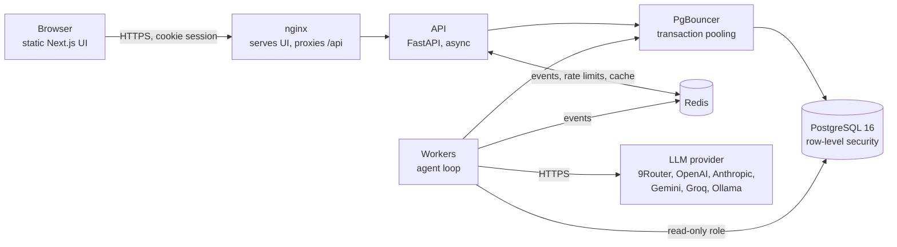
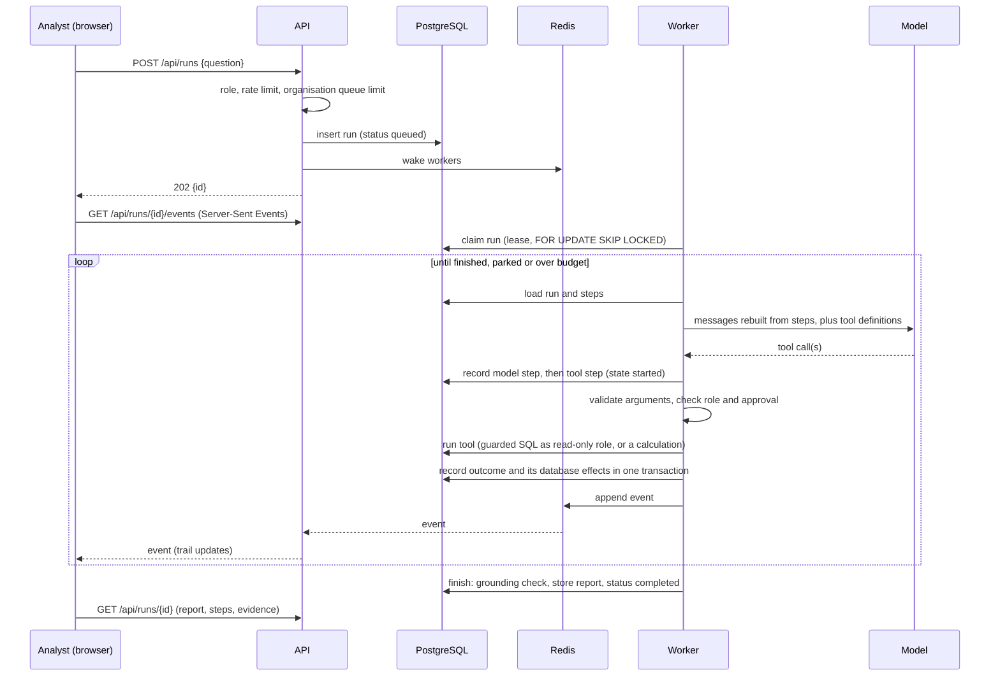

# Architecture

The diagram is generated from [`architecture.diagram.json`](architecture.diagram.json); an [interactive version](https://rafi0020.github.io/FinOps-Agent/diagram/) is also available, and a static image is in [`architecture.png`](architecture.png).

## Overview

Five kinds of container: `web` (nginx), `api`, `worker`, `db` with `pgbouncer`, and `redis`. A sixth,
`migrate`, runs once at start-up to apply migrations and load the demo data, then exits.

## What happens when someone asks a question

## Components

| Component | Responsibility | Files |
|---|---|---|
| Agent runtime | The loop, generic over any tool set: decide next action from stored steps, run it, commit, publish | `app/agent/runtime.py`, `context.py`, `budgets.py`, `events.py`, `tools.py` |
| Worker | Claim runs under a lease, renew it, hand back on shutdown, recover abandoned runs; scheduled jobs | `app/worker/run.py`, `scheduler.py` |
| LLM layer | One interface, adapters per provider, retry, fallback, concurrency cap, cost estimate | `app/llm/` |
| Finance tools | Catalogue, guarded SQL, deterministic calculations, charts, findings, grounded report, alert proposals | `app/finance/` |
| API | Accounts, runs, live events, approvals, investigations, alerts, usage, settings, audit | `app/api/` |
| Security | Passwords, sessions, CSRF, rate limits, headers, encryption, redaction | `app/security/` |
| Observability | JSON logs, Prometheus metrics, OpenTelemetry spans | `app/obs/` |
| UI | Nine screens; the run trail and the evidence-linked report | `frontend/src` |

`app/agent/` imports nothing from `app/finance/`. The finance agent is one `AgentSpec` (instructions plus a
tool registry) handed to the generic runtime; another agent would be another `AgentSpec`.

## Design decisions

**A hand-written agent loop instead of a framework.** The loop is about 400 lines. Writing it keeps every
mechanism visible and testable: what is stored, when it is committed, how a crash is recovered. Current
guidance from model providers favours direct API calls and simple composable patterns for bounded,
tool-driven work like this. The cost is that streaming of partial model output, sub-agents and graph
visualisation are not provided for free.

**Runs live in PostgreSQL, not in a queue.** A run is long, has many steps and must resume mid-way. With the
run, its steps and the claim on it in one transactional store, a step and its result commit together and a
dead worker's lease simply expires. Redis carries only what can be lost: live events, rate-limit counters,
caches.

**The database is the security boundary for model-written SQL.** The query runs as a role that can only read
schema `analytics`, in a read-only transaction, under row-level security, with a time limit and a row cap,
and cannot change which organisation it sees. The SQL parser is a second layer that produces useful error
messages. See `SECURITY.md`.

**Row-level security for tenancy.** The organisation is set once per transaction (`SET LOCAL`, which is what
works under transaction pooling) and PostgreSQL filters every table. A missing `WHERE org_id = …` in
application code cannot leak another organisation's rows.

**Effects are committed with their record.** A tool's database writes are applied in the transaction that
marks its step done, which gives exactly-once effects without an outbox table.

**The model does no arithmetic and its numbers are checked.** Calculations are deterministic functions over
stored results; the report's figures are matched against the evidence before it is accepted.

**Static UI.** The frontend is exported to plain files served by nginx. There is no Node server in
production, which removes a runtime and its attack surface. The browser talks to one origin; nginx proxies
`/api`, including Server-Sent Events.

**Polling inside the event stream.** Each open event stream polls its run's Redis stream every 0.4 s rather
than holding a blocking read, so thousands of open tabs share a small Redis connection pool. Events can
arrive up to 0.4 s late.

## Failure handling

| Failure | Behaviour |
|---|---|
| Worker killed mid-run | Lease expires (30 s); another worker claims the run and continues from the last committed step |
| Worker killed mid-tool | A read tool is run again; a tool with outside effects is not repeated and the model is told it was interrupted |
| Run crashes workers repeatedly | Failed as abandoned after 5 attempts |
| Model timeout, 429 or 5xx | Retried up to 4 times with back-off and jitter, honouring `Retry-After`; then the fallback model once; then the run fails with the provider's message |
| Model returns a bad tool call | Returned to the model as an error; two in a row fail the run |
| Model answers in prose instead of calling a tool | Reminded once; a second time fails the run |
| Tool raises or times out | Recorded; the model sees a safe message, never the stack trace |
| Query too slow or too large | Cancelled at 10 s; results capped at 5,000 rows and marked truncated |
| Run exceeds a budget | Ends as `budget_exceeded`; evidence so far is kept |
| Redis unavailable | Workers fall back to polling for work; signed-in requests read sessions from the database; rate-limited routes return 503 with `Retry-After`; no run is lost |
| Browser disconnects | The event stream resumes from the last event id on reconnect |
| Deploy (SIGTERM) | Workers stop claiming and hand unfinished runs back immediately |

## What is not here

Streaming of partial model text to the browser, sub-agents, long-term memory across runs, an MCP server
exposing the tools, e-mail or webhook delivery of alerts, single sign-on, and Kubernetes manifests.
